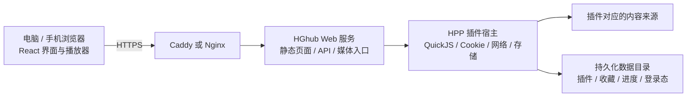

# HGhub Web 版改造实施方案（路线 A）

> 状态：草案，尚未实施。本文只描述改造路径与验收标准，不代表代码已修改。
> 适用对象：客户端维护者。插件作者视角的接口约定见 [插件协议](plugin-protocol/README.md)。

## 1. 背景与目标

HGhub 是**通过插件连接不同内容来源的通用播放器**，自身不内置内容源。用户导入 JavaScript 插件后，才获得搜索、浏览、播放、登录和互动能力。

当前形态是 Tauri 桌面/移动应用，三层结构如下：

| 层次 | 技术 | 职责 |
| --- | --- | --- |
| 界面层 | React、TypeScript、Vite、Tailwind CSS、hls.js | 页面、交互、视频播放 |
| 原生应用层 | Tauri 2 | 窗口、文件选择、系统打开、原生网页登录 |
| 插件宿主层 | Rust、QuickJS、reqwest、axum | 插件执行、网络、Cookie、存储、媒体代理 |

改造目标：**浏览器前端 + Rust 服务端**的自托管 Web 应用。保留现有 React 界面与 HPP 插件宿主，在两者之间增加正式 HTTP 接口，并把媒体代理改为同源访问。

第一版定位：**单用户部署在服务器或 NAS 上，用电脑与手机浏览器访问，收藏与进度由服务端统一保存。** 多人账号版作为后续阶段。

不做的事：

- 不把 QuickJS 编译进浏览器、不重写插件运行时。
- 不改为纯前端无服务端形态（CORS、防盗链媒体、RSA PKCS#1 v1.5、Cookie 罐、WebView 登录都会失效）。
- 不做服务端视频转码。
- 第一版不实现多用户账号体系。

## 2. 现状与耦合点

复用的关键前提是宿主已经与传输层解耦：

- 插件动作统一经 [ipc.rs](../src-tauri/crates/hpp/src/ipc.rs) 的 `dispatch(manager, action, params)` 执行。
- 界面侧所有插件调用集中在 [client.ts](../src/plugins/client.ts) 的 `pluginCommand`，另有少量零散命令：`app_boot`、`debug_log`、`open_url`、`open_external_media`、`pick_plugin_files`、`pick_plugin_directory`、`security_set`、`set_orientation`，以及窗口控制（注册列表见 [lib.rs](../src-tauri/src/lib.rs)）。
- 已有现成验证：开发宿主 [dev_host.rs](../src-tauri/crates/hpp/examples/dev_host.rs) 用 stdio JSON lines 驱动同一 dispatcher；浏览器测试入口 [tests/plugins.tsx](../tests/plugins.tsx) 只替换 IPC 传输为 `fetch`，其余跑生产 React 代码。

因此 Web 改造的主要工作在**服务端外壳、平台适配，以及原生单设备模型的状态归属调整**，而不是重写播放器或插件系统。

必须在实施前处理的问题：当前 [manager.rs](../src-tauri/crates/hpp/src/manager.rs) 中的 `PluginManager` 只保存一份 `media_capabilities`，`configure_media` 在能力变化时会停止旧运行时并释放相关媒体会话。多设备同时接入且播放能力不同时，会互相打断。

## 3. 目标架构



对外只有单一域名：

```text
https://hghub.example.com/             页面
https://hghub.example.com/api/...      管理与内容接口
https://hghub.example.com/media/...    图片、视频、字幕
```

请求流向：

1. 用户打开网站并登录 HGhub。
2. 浏览器向服务端请求搜索或播放。
3. Rust 宿主运行插件并访问内容来源。
4. 视频、图片、字幕由服务端代理给浏览器。
5. 浏览器负责解码播放；服务端保存收藏与进度。

服务器因此成为内容来源看到的出口，也承担媒体转发流量。**服务器所在地区、出口网络与带宽直接决定内容可用性与播放体验**，不能只按浏览器所在网络判断。

## 4. 需要准备的服务器与基础设施

| 项目 | 第一版建议 | 作用 |
| --- | --- | --- |
| 运行设备 | Linux VPS、家用服务器或 NAS | 持续运行 Rust 服务 |
| CPU | 2 核起步 | 插件执行、网络处理、媒体转发 |
| 内存 | 建议 2–4 GB 起步 | 服务、插件运行时及有界缓存 |
| 磁盘 | 持久化数据预留 10–20 GB 起步 | 插件、登录态、片库、日志与更新临时文件 |
| 网络 | 能访问目标来源，具备足够上下行能力 | 请求来源并输出媒体 |
| HTTPS | 公网部署必需，推荐 Caddy 自动证书 | 页面、认证与媒体统一安全传输 |
| 域名 | 公网访问推荐；仅内网可先不用 | 稳定访问与证书配置 |
| 进程管理 | Docker Compose 或 systemd | 自动启动、故障重启 |
| 备份 | 数据目录定期备份 | 恢复插件配置、收藏、进度与登录态 |

以上为**起步建议，未经过本项目 Web 版压测**。每插件有独立运行时与内存预算，实际占用还取决于同时加载的插件数、播放会话数量与缓存策略。

带宽通常先于 CPU 成为瓶颈。以一路平均 **8 Mbps** 的视频为例：

- 服务端从来源接收约 8 Mbps。
- 再向浏览器发送约 8 Mbps。
- 每小时出站约 **3.6 GB**（未计协议开销）。

三路并发播放约需 24 Mbps 持续出站带宽，另需波动余量。选购 VPS 时重点是**持续带宽与月流量额度**，而不是峰值 CPU。

第一版不引入 Redis、消息队列、对象存储或 Kubernetes。现有数据采用文件持久化可先复用；待多人共享与并发写入需求明确后，再评估迁移 SQLite 等数据库。

## 5. Web 版需要支持的能力

| 能力 | 第一版处理 |
| --- | --- |
| 推荐、搜索、分类、详情 | 复用现有页面与插件调用 |
| MP4、HLS、直播 | 保留媒体宿主，增加同源访问入口 |
| 图片与字幕 | 同样经媒体入口，保留资源提供者归属 |
| 收藏、历史、进度 | 保存到服务端，实现多设备共享 |
| 插件网址导入、粘贴代码 | 复用现有导入流程 |
| 本地文件导入 | 浏览器读取并上传，服务端校验后安装 |
| 本地列表与相对路径 | 配套文件上传与预览流程，不把客户端路径当服务器路径 |
| 插件订阅与更新 | 复用现有更新机制及播放延后规则 |
| HGhub 自身更新 | 更新服务镜像或二进制，并配套更新前端 |
| 普通认证表单 | 按现有插件能力复用 |
| 原生 WebView 登录 | 第一版不声明支持 `webview`，后续单独设计 |
| 外部播放器与协议链接 | 用户点击后由浏览器尝试打开本机处理程序 |
| 全屏与屏幕方向 | 使用浏览器 API，按实际支持呈现 |
| 原生标题栏、拖动、窗口缩放 | Web 模式移除对应控件 |
| 日志与诊断 | 服务端记录，管理页按需查看并脱敏 |

补充说明：

- SSE/WebSocket 不是第一版必需项。当前多数界面更新事件在请求成功后由前端触发；需要多标签页同步或后台进度推送时再增加。
- 插件自动更新已在 Rust 宿主中实现，Web 版需调整触发条件与权限，而非重写更新器。
- 服务端不能替远程用户调用系统 opener 打开链接，必须由用户自己的浏览器或设备处理。
- 原生网页登录涉及跨站页面、Cookie 移交与隔离，不能简单用弹窗替代；第一版应准确声明缺少 `webview`，让依赖它的插件按 [07 章](plugin-protocol/07-ecosystem.md) 判为不兼容。

## 6. 实施阶段

### 阶段 1：确定 Web 运行边界与状态模型

先定义三种身份，避免把原生单设备模型直接搬到网络：

| 身份 | 生命周期 | 拥有什么 |
| --- | --- | --- |
| 用户 | 长期 | 插件安装、设置、Cookie、收藏、进度 |
| 客户端 | 一个浏览器标签页或连接上下文 | 播放能力、在途请求、当前播放 |
| 媒体会话 | 一次播放或一批资源 | 视频、图片、字幕及取消状态 |

建议：

- 用户持久数据统一保存。
- 播放能力、取消请求与媒体会话按客户端隔离。
- 第一版允许各设备共享片库，但每个客户端独立播放。
- 浏览器缓存键包含客户端、插件修订等必要信息，避免复用过期结果。
- 安装、更新与设置变更继续按现有规则使依赖旧环境的会话失效。

具体实现须在核对协议后确定，不能简单创建多个管理器并同时写同一数据目录。

**验收标准：** 数据归属明确；两个播放能力不同的客户端不会通过能力注册互相释放播放会话。

### 阶段 2：新增独立 Rust Web 服务

新增一个与 Tauri 并列的 Web 服务 crate，直接依赖现有 `hghub-hpp`。

职责：

- 读取配置：监听地址、数据目录、外部访问地址、认证配置。
- 初始化插件宿主。
- 提供 API、上传入口、健康检查与静态页面。
- 将业务动作转发到现有 dispatcher。
- 处理退出清理与服务日志。

接口草案：

```text
GET  /healthz
POST /api/auth/login
POST /api/auth/logout
GET  /api/bootstrap
POST /api/rpc
POST /api/uploads/plugins
GET  /media/...
HEAD /media/...
```

`/api/rpc` 继续承载现有 `action + params`，保留插件错误码与业务返回结构；HTTP 层单独处理未登录、请求格式错误与上传超限等边界错误。

必须同时落实：

- 即使只有一个用户，也提供访问认证。
- 同源会话 Cookie、写请求 CSRF 防护与来源检查。
- 请求体、上传大小与调用速率限制。
- 不允许前端提交任意服务器文件路径。
- 管理配置与普通播放操作区分权限。
- 公网部署时不允许普通客户端随意关闭服务端的内网访问防护。

**验收标准：** 无需 Tauri 即可登录并通过 HTTP 获取插件列表、完成一次真实插件调用；未登录请求被拒绝。

### 阶段 3：前端抽出平台适配层

集中入口是 [client.ts](../src/plugins/client.ts)，同时需处理分散在设置、文件导入、播放器与外壳中的原生命令。

```text
业务页面
   ↓
统一的平台接口
   ├─ Tauri：现有 invoke 与窗口 API
   └─ Web：fetch、上传、浏览器全屏与链接打开
```

实施内容：

1. 区分"运行容器"与"设备系统"：Web/Tauri 与 Android/Windows 分开判断（现有 [environment.ts](../src/environment.ts) 只判断设备系统）。
2. 插件请求改走统一传输入口。
3. 文件导入、链接打开、全屏、窗口操作分别适配。
4. Web 模式去掉关闭应用、拖动标题栏、原生缩放等入口。
5. 增加登录页与会话过期处理。
6. 服务不可用时显示明确状态。
7. 清点本地偏好：片库等长期业务数据统一服务端保存；音量、布局等设备偏好可留本地。
8. 不要把测试中的 `__TAURI_INTERNALS__` 注入方式用于生产。

**验收标准：** 浏览器入口可完成登录、浏览与插件管理；原生版本仍走原适配器。

### 阶段 4：媒体代理改造成正式 Web 入口

这是播放能否完整工作的关键。当前 [media.rs](../src-tauri/crates/hpp/src/media.rs) 启动服务器本机随机回环端口；远程浏览器收到 `127.0.0.1` 地址会访问浏览器自身设备，必须调整。

目标：所有资源返回 `https://hghub.example.com/media/会话/资源` 形式的地址。建议把资源处理能力提取为可复用 Router，挂到 Web 服务上，同时保留原生回环监听适配。

必须覆盖：

- MP4 流式转发，不整段载入内存。
- GET、HEAD、Range、If-Range，以及正确 200/206/416。
- HLS 主清单、子清单、音轨、字幕、分片、密钥与初始化段改写。
- 图片请求头、Cookie、字幕转换与字节变换。
- 资源提供者、解析器与登录态保持原有隔离。
- 媒体会话校验用户与客户端归属。
- 浏览器关闭或断线后依靠会话过期机制回收资源。
- 反向代理不整段缓冲视频，不错误缓存带身份的媒体响应。

HTML 视频与图片请求不方便统一附加自定义认证头，第一版推荐同源会话 Cookie；服务端仍须校验资源归属，不能只依赖地址不可猜测。

**验收标准：** 在另一台设备上通过 HTTPS 完成播放、拖动、字幕显示、HLS 密钥加载、地址刷新与取消；返回地址中不泄漏内部回环端口。

### 阶段 5：服务器部署与维护流程

```text
Caddy
  └─ HGhub Web 服务
       ├─ 内置前端构建产物
       └─ 挂载持久化数据目录
```

交付内容：

- 可重复构建的服务二进制或 Docker 镜像。
- Docker Compose 部署示例。
- 配置示例与首次登录初始化流程。
- 数据目录、权限、日志轮转与健康检查说明。
- 备份、恢复、升级与回滚步骤。
- SIGTERM 等退出信号下的清理流程。

升级时保证前后端版本匹配；备份使用停服或一致性快照策略，不能假定复制正在修改的文件一定一致。登录态属于敏感数据，备份同样需要限制访问。

**验收标准：** 干净服务器能按文档部署；重启后数据保留；备份可恢复；升级失败可回退。

### 阶段 6：验证与文档同步

| 层次 | 核心验证 |
| --- | --- |
| Rust 接口 | 认证、上传、请求校验、错误映射、客户端隔离 |
| 浏览器集成 | 登录、搜索、详情、播放、收藏、续播、插件更新 |
| 真实部署 | HTTPS、远程手机访问、带宽、重启、备份恢复 |

重点场景：

- 电脑播放时手机接入，不相互打断。
- 两个标签页独立取消请求。
- 带头图片、Cookie 媒体、多级 HLS 与字幕正常。
- 插件更新使旧会话按既有契约失效。
- 服务重启后恢复片库，旧临时媒体会话明确失效。
- 未授权客户端不能访问其他客户端的媒体资源。
- 服务端内网访问规则、全局代理配置与日志脱敏符合部署边界。

实现前需按仓库约定完整核对涉及的协议章节。Web 托管改变数据落点与媒体传输边界，**不能预先认定协议完全不用修改**；应同步检查协议、实现状态、公开类型与部署资料。公开资料变更后执行 `pnpm docs:build` 与 `pnpm docs:test`；线上发布按既有手动 Pages 流程处理。

## 7. 里程碑与投入预估

按一名熟悉 Rust 与 React 的开发者估算，属规划值，非已验证工期：

| 里程碑 | 交付物 | 预计投入 |
| --- | --- | --- |
| M1 | 状态归属设计、独立服务、HTTP 插件调用 | 3–5 人日 |
| M2 | 平台适配、登录、插件上传与管理 | 3–5 人日 |
| M3 | 同源媒体、远程播放、多客户端隔离 | 5–8 人日 |
| M4 | 部署、备份恢复、回归与文档 | 4–7 人日 |
| 合计 | 可自托管的单用户、多设备 Web 版 | **15–25 人日** |

仅做演示可以更快跑通"页面 → API → 单路播放"；正式可用版本必须完成媒体边界、客户端隔离与部署验证。

## 8. 风险与决策点

按影响排序：

1. **媒体传输**：HLS 改写、Range 语义、认证与反向代理缓冲，最容易出隐性错误。
2. **多客户端能力隔离**：现有 `configure_media` 是全局语义，直接暴露给多设备会互相打断。
3. **开放代理风险**：服务端替浏览器访问任意来源，公网部署必须做认证、限速与内网访问防护，否则等于对外提供匿名代理。
4. **文件导入交互**：浏览器没有原生文件选择器，需要重新设计上传与相对路径语义。
5. **自身更新与部署**：Tauri updater 不再可用，改为镜像/二进制升级流程。

需要先定下来的决策：

- 第一版是否只支持单用户、多设备共享同一份数据。
- 是否需要 `webview` 能力（决定部分插件是否被标记不兼容）。
- 反向代理选型（Caddy 自动证书 vs Nginx 手动配置）。
- 是否坚持纯文件持久化，还是第一版就引入 SQLite。

## 9. 与 HPP 协议的关系

本次改造落在运行时、网络、宿主 API 与媒体传输上，属于仓库协作约定中的插件边界改动。实施前须完整阅读 [02 运行时](plugin-protocol/02-runtime.md)、[03 宿主规则](plugin-protocol/03-host-rules.md)、[04 宿主 API](plugin-protocol/04-host-api.md) 与 [09 媒体传输](plugin-protocol/09-media-transport.md)，并核对 [实现进度](plugin-protocol/IMPLEMENTATION.md) 与 [支持状态](developers/status.md)。

预期影响：

- 新增宿主适配器本身不改协议签名，但 Web 平台的能力声明须如实反映（不声明 `webview`）。
- 数据落点从"应用数据目录"变为"服务端数据目录"，需确认 04 章存储与 Cookie 语义在托管场景下是否需要补充说明。
- 平台矩阵与支持状态需更新，新增 Web 宿主部署说明。

## 10. 已落地进展（2026-11-25）

已完成的最小垂直切片，均经过实际验证，不是设计推演：

- 新增 Web 服务 crate [web](../src-tauri/crates/web/src/main.rs)，直接依赖 `hghub-hpp`，提供 `GET /healthz` 与 `POST /rpc`（承载现有 `action + params`，返回 `{ok, value}` 或 `{ok, error}`）。
- 部署机为 FreeBSD 14.3 共享主机（serv00），`rustc`/`cargo` 1.95 由该主机提供；`hghub-hpp` 在 FreeBSD 上需为 `rquickjs` 开启 `bindgen` 生成绑定，已按 [hpp 清单](../src-tauri/crates/hpp/Cargo.toml) 的条件依赖扩展到 `target_os = "freebsd"`（绑定时需设置 `LIBCLANG_PATH`）。
- 实测编译耗时约 2 分钟，产物直接在该主机运行，服务通过预留 TCP 端口对外可达；`/healthz` 返回 `{"ok":true}`，`/rpc` 的 `list` 与未知动作的错误映射均符合预期。
- `/rpc` 已要求 `Authorization: Bearer` 令牌，未携带时返回 401；`/healthz` 保持公开以便健康检查。
- 该账号的硬限制（按 `devil info limits`）：内存 512 MB、进程 20 个、磁盘配额 3 GB。这会直接约束同时加载的插件数量与播放会话数，属于第一版必须纳入的部署约束，也说明正式环境更适合独立 VPS。
- 已配置每 10 分钟的健康检查 cron，用于进程被回收后自动恢复。

### 10.1 阶段 4 与阶段 3 首切片（同日）

- 媒体资源改由 Web 服务自身同源提供：`MediaSessions::use_public_base` 固定对外前缀，`media::router` 复用到主服务上，播放地址形如 `http://<host>:<port>/hpp/<session>/<index>`。实测浏览器 `<video>` 拿到 206、`readyState=4`、可正常播放与计时。
- 修复首启竞态：宿主启动时先 `initialize_enabled()`，否则首次 `media.prepare` 记录到过期插件修订，随后的资源请求会被判为 CANCELLED。
- 服务端新增 `HGHUB_WEB_ROOT` 静态托管、`GET /login?token=` 一次性换取 HttpOnly 会话 Cookie；`/rpc` 同时接受 Bearer 与 Cookie。
- 前端新增 [transport.ts](../src/platform/transport.ts) 平台层：Tauri 走原有 `invoke`，浏览器走同源 `/rpc`；桌面外壳保留布局与导航（标题栏、侧栏、搜索、插件中心、设置、我的），只去掉窗口控制按钮、缩放手柄与窗口拖拽，侧栏版本号显示为 Web。
- [ids.ts](../src/platform/ids.ts) 提供请求 ID 生成：`crypto.randomUUID` 在非安全上下文（明文 HTTP）不存在，纯 HTTP 部署会直接崩页。
- 登录后首页、搜索、片库与播放均已在真实浏览器中跑通。

### 10.2 对外 HTTPS（2026-11-25）

- 域名 `hub.convertgb.shop` 经 Cloudflare 代理对外提供 HTTPS；根域与 `www` 仍指向原 Vercel 站点，未改动。
- 因源站只拿到 5977 这类非标准端口（serv00 禁止自行预约 8080），用 **Origin Rule** 把目的端口改到 5977（官方允许 1–65535），并用 **Configuration Rule** 仅对该主机名设置 SSL 模式为 Flexible，避免影响同区其他站点。
- 源站与服务端无需改动即可被代理访问；`HGHUB_PUBLIC_BASE` 改为 `https://hub.convertgb.shop`，媒体地址随之同源。
- 实测：`/healthz` 200、登录 303 种 Cookie、`media.prepare` 返回同源 https 地址、Range 请求 206（`bytes 0-2047/4372373`）、浏览器中 `readyState=4` 正常播放、页面为安全上下文。
- 已知取舍：CF→源站为明文（Flexible），5977 仍对公网可达，可绕过 CF；Cloudflare 免费套餐不面向视频分发，长期大流量有被限速风险。
- 2026-11-25 决策：采用**混合路由**——页面与接口走干净地址（Cloudflare 终止 TLS），媒体直连源站端口，避免大流量经免费 CDN：

  | 用途 | 地址 | 是否经 CF | 说明 |
  | --- | --- | --- | --- |
  | 页面与接口 | `https://hub.convertgb.shop` | 是 | 橙云 + Origin Rule，源站 HTTP 监听 28106 |
  | 媒体（视频/图片/字幕） | `https://media.convertgb.shop:5977` | 否 | 灰云直连，源站用 Let's Encrypt 证书终止 TLS |

- 不带端口的地址在共享主机上只能由 CF 终止 TLS（443 被 serv00 占用，标准端口无法预约），因此“干净地址 + 直连媒体”必须使用两个主机名。
- 媒体是跨源请求：宿主响应带 `Access-Control-Allow-Origin: *`，播放器元素带 `crossOrigin="anonymous"`，媒体会话以不透明 UUID 引用，不依赖 Cookie。
- 源站同时监听 5977（TLS）与 28106（明文，仅用于 CF 回源）；`HGHUB_PUBLIC_BASE` 指向媒体地址，页面内的媒体 URL 因此走直连域名。

尚未开始：多客户端隔离、插件上传接口、CSRF 与限速、备份与镜像化部署。

已知限制：明文 HTTP 下浏览器只提供有限 Web API（`crypto.randomUUID`、Service Worker 等不可用），正式对外必须终止 TLS；媒体地址目前仅以会话 UUID 保护，未做逐用户校验。
